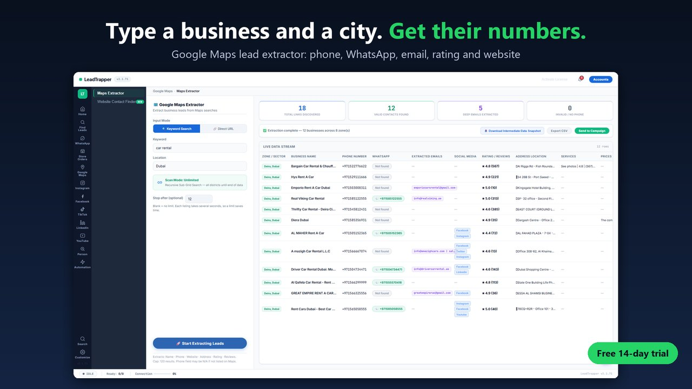
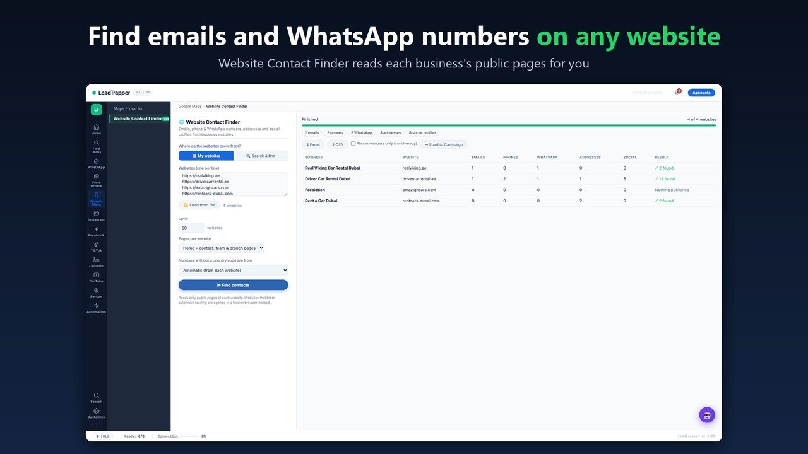
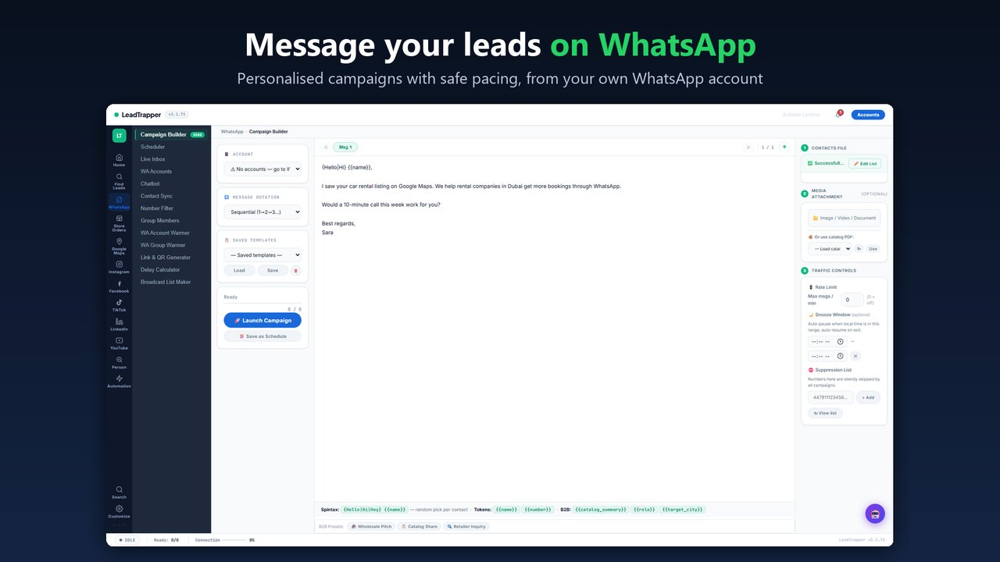
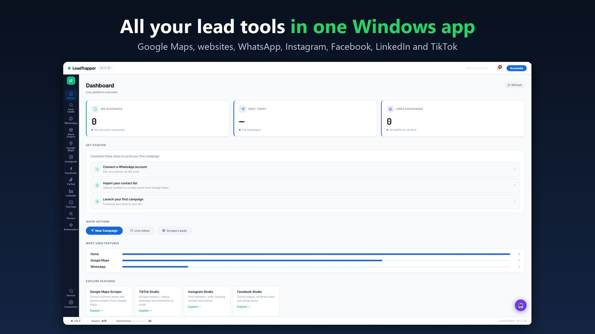

# LeadTrapper: find business leads on Google Maps, message them on WhatsApp

**A Windows app for small businesses, agencies and sales teams. Type a business type and a city, get their phone numbers, WhatsApp numbers and emails, then reach them on WhatsApp, all from one app.**

🌐 **Website:** [useleadtrapper.com](https://useleadtrapper.com) · 🪟 **Microsoft Store:** [LeadTrapper](https://apps.microsoft.com/detail/9MTMWQ762H25) · ▶️ **Video guides:** [YouTube](https://www.youtube.com/channel/UCgzbTeG11pHQGNqtYaWnTVA)

---

## What it does

1. **Find businesses.** Type a business type and a city, for example "dentist" and "Dubai". LeadTrapper collects the public Google Maps listings: business name, phone number, address, rating, number of reviews and website.
2. **Get their contact details.** The Website Contact Finder reads each business website for the email addresses, WhatsApp numbers and social profiles it publishes.
3. **Reach them on WhatsApp.** Check which numbers are on WhatsApp, then send personalised campaigns, paced by the built-in delay calculator.

## Features

- **Google Maps lead extractor:** phone, address, rating, reviews and website for any business type, in any city (Arabic names included)
- **Website Contact Finder:** emails, phone and WhatsApp numbers, addresses and social profiles from business websites
- **Number Filter:** check which phone numbers are on WhatsApp before you message them
- **WhatsApp campaigns:** personalised messages, message rotation, scheduling and a delay calculator for safe pacing
- **Broadcast List Maker:** turn a phone list into WhatsApp-ready contacts
- **Several WhatsApp accounts** in one app, with an account warmer
- **Instagram, Facebook, LinkedIn, TikTok and YouTube lead tools** (sign in with your own account)
- **WhatsApp chatbot and AI auto-replies** from your own knowledge base
- **Store Orders:** automatic WhatsApp order messages for Wix and Shopify stores
- **Export** to Excel and CSV

## Private by design

Everything runs on your own computer. The leads you collect, your contacts, your messages and your WhatsApp session stay on your PC and are never sent to us.

## Pricing

**Free 14-day trial with every feature, no credit card.** After the trial, a licence is **$50 per year**: no monthly fees, no per-lead charges. Store Orders and all the free tools below stay free.

[Get LeadTrapper from the Microsoft Store](https://apps.microsoft.com/detail/9MTMWQ762H25?cid=github_readme&mode=direct)

## Free tools (no sign-up)

**On the website**
- [WhatsApp Link Generator](https://useleadtrapper.com/tools/whatsapp-link-generator/)
- [WhatsApp Number Formatter](https://useleadtrapper.com/tools/whatsapp-number-formatter/)
- [WhatsApp Broadcast List Maker](https://useleadtrapper.com/tools/whatsapp-broadcast-list-maker/)

**Browser extensions**
- [Contact Finder](https://useleadtrapper.com/articles/extract-contact-details-from-website/) (Chrome)
- [WhatsApp Link & QR Generator](https://useleadtrapper.com/articles/whatsapp-link-qr-generator/) (Chrome, Firefox)
- [Group Contacts Extractor](https://useleadtrapper.com/articles/how-to-export-whatsapp-group-contacts/) (Chrome)
- [Google Maps Lead Extractor](https://useleadtrapper.com/articles/google-maps-lead-extractor/) (Edge)
- [WhatsApp Delay Calculator](https://useleadtrapper.com/articles/whatsapp-delay-calculator/) (Edge)

**For online stores**
- [WhatsApp Order & Chat for Wix](https://useleadtrapper.com/articles/wix-whatsapp-order-button/)

All free tools: [useleadtrapper.com/tools](https://useleadtrapper.com/tools/)

## Who it is for

- Agencies and freelancers who find clients for themselves or their customers
- Real estate, car rental, clinics, restaurants and other local businesses
- B2B sales teams in the UAE, Saudi Arabia, Egypt, the UK and anywhere Google Maps lists businesses

## Requirements

Windows 10 or 11 (64-bit) with Microsoft Edge, which is already on every Windows PC. Messaging features need your own WhatsApp account; Instagram, Facebook and LinkedIn features need your own account on that site.

## Learn more

- 📖 Guides and articles: [useleadtrapper.com/articles](https://useleadtrapper.com/articles/)
- ▶️ Video guides: [YouTube](https://www.youtube.com/channel/UCgzbTeG11pHQGNqtYaWnTVA)
- 💼 [LinkedIn](https://www.linkedin.com/company/useleadtrapper) · 🐦 [X](https://x.com/useLeadTrapper)
- 📬 Contact: [useleadtrapper.com/contact](https://useleadtrapper.com/contact/)

---

This repository is LeadTrapper's public page on GitHub. The app's source code is private. App updates are published in [leadtrapper-updates](https://github.com/mohmmedshz-svg/leadtrapper-updates).
